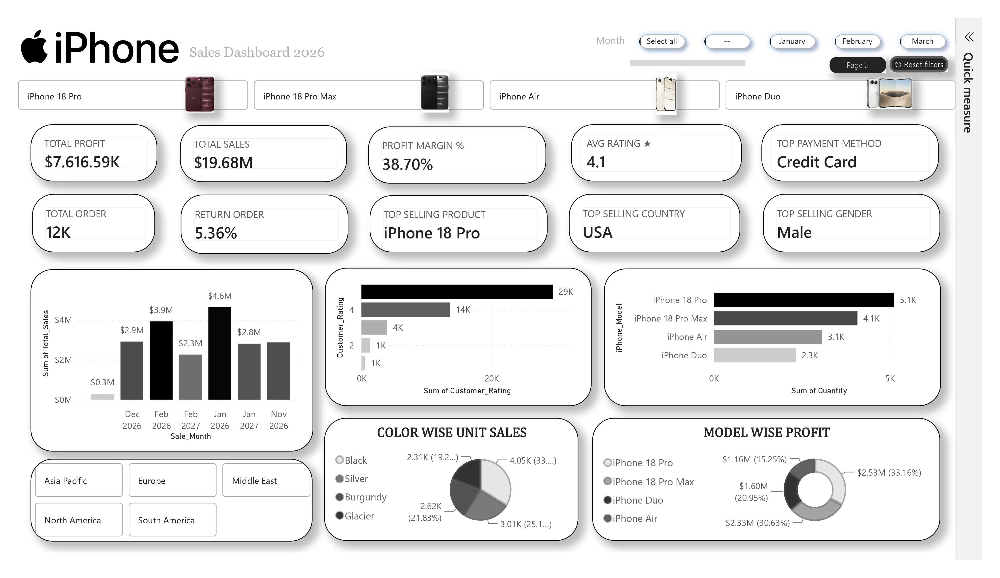
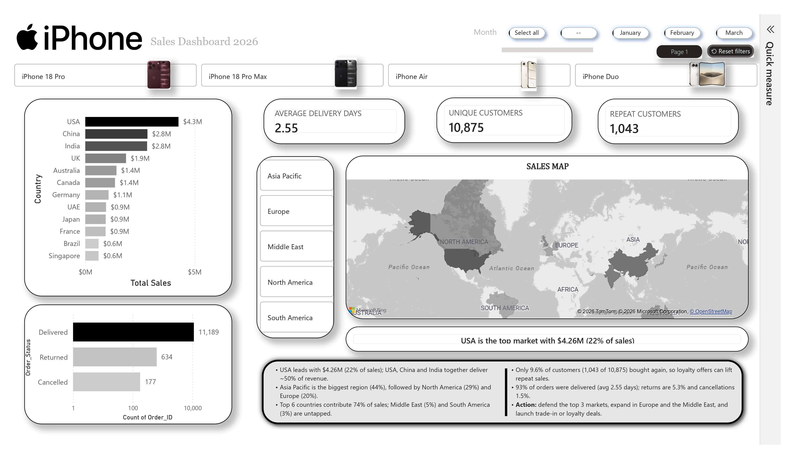

# iPhone Worldwide Sales Analytics Dashboard (Power BI)

An end-to-end sales analytics project on a **synthetic** worldwide iPhone sales dataset (launch lineup: iPhone 18 Pro, 18 Pro Max, Air and Duo). The Power BI report tracks revenue, profit, customers, geography and order quality across 12 countries.

> **Note:** the data is simulated for learning and portfolio purposes. It is not real Apple sales data.

## Dashboard Preview
| Page 1: Overview | Page 2: Geography & Customers |
|---|---|
|  |  |

## Business Questions
- Which models, countries and regions drive revenue and profit?
- How did sales behave after the launch (Sep 2026 to Feb 2027)?
- How loyal are customers, and how healthy are returns, cancellations and ratings?
- Which payment methods and sales channels matter most?

## Dataset
- **12,000 orders**, 28 columns, 18 Sep 2026 to 28 Feb 2027, 12 countries, 4 regions
- Fields cover order, customer, product, price, discount, cost, profit, payment, channel, delivery and rating
- Full column list: [docs/data_dictionary.md](docs/data_dictionary.md)
- Files: `data/iphone_worldwide_sales_dataset.xlsx` (with Country_Reference, Price_List and Summary_Check sheets) and `.csv`

## Tools
Power BI Desktop, DAX, Power Query, Excel

## KPIs
Total Sales, Total Profit, Profit Margin %, Total Orders, Units Sold, Average Order Value, Month-over-Month %, Return Rate, Cancel Rate, Unique and Repeat Customers, Average Rating, Average Delivery Days, Top Product / Country / Gender / Payment Method.
All measures are in [powerbi/measures.dax](powerbi/measures.dax).

## Key Insights
1. **Revenue:** $19.68M sales, $7.62M profit (38.7% margin) from 12,000 orders; average order value is about $1,640.
2. **Products:** iPhone 18 Pro leads with 5.1K units and 33% of profit. Pro Max has the best margin (about 42%). Duo sells only 16% of units but earns more sales than Air; Air is the weakest model.
3. **Geography:** USA is the top market ($4.26M, 22%). USA, China and India deliver about 50% of sales; the top 6 countries deliver 74%.
4. **Regions:** Asia Pacific 44%, North America 29%, Europe 20%, Middle East 5%, South America 3%. The last two are untapped.
5. **Trend:** Launch days (18-30 Sep) produced $4.2M. Sales peaked in Oct ($4.6M), then settled near $2.8-2.9M per month and fell to $2.3M in Feb. The daily run-rate dropped about 75% from launch.
6. **Customers:** only 9.6% of customers (1,043 of 10,875) purchased again, so loyalty and trade-in offers can lift repeat sales.
7. **Quality:** 93% of orders delivered (2.55 days on average), 5.4% returns, 1.5% cancellations, average rating 4.1 of 5.
8. **Payments and channels:** Credit Card is used most (28.5% of orders); Apple Online Store is the largest channel ($5.3M).

## Recommendations
Defend the top 3 markets, grow Europe and the Middle East, review Duo pricing and cost (lowest margin), and launch loyalty offers to raise repeat purchases.

## Data Model
- **iphone_sales_dataset** (fact table, 12,000 rows), **Date Table** (one row per day, with Month Year and YearMonth for sorting), **Price_List** (reference prices and costs).
- Relationship: `Date Table[Date]` to `iphone_sales_dataset[Sales_Date]` (many-to-one, single direction).
- Details: [docs/data_model.md](docs/data_model.md), [powerbi/power_query.m](powerbi/power_query.m).

## Repository Structure
```
data/      dataset (xlsx, csv)
powerbi/   .pbix report, DAX measures, Power Query (M)
images/    dashboard screenshots
docs/      data dictionary
```

## How to Use
1. Download the repo and open `powerbi/Data_Iphone.pbix` in Power BI Desktop.
2. If the data source path breaks, go to Transform data, Data source settings and point to `data/iphone_worldwide_sales_dataset.xlsx`.

## Author
**Mahesh Thakor** | Data Analytics | [LinkedIn](https://www.linkedin.com/in/mahesh-thakor-4ba067384) | Gujarat, India
